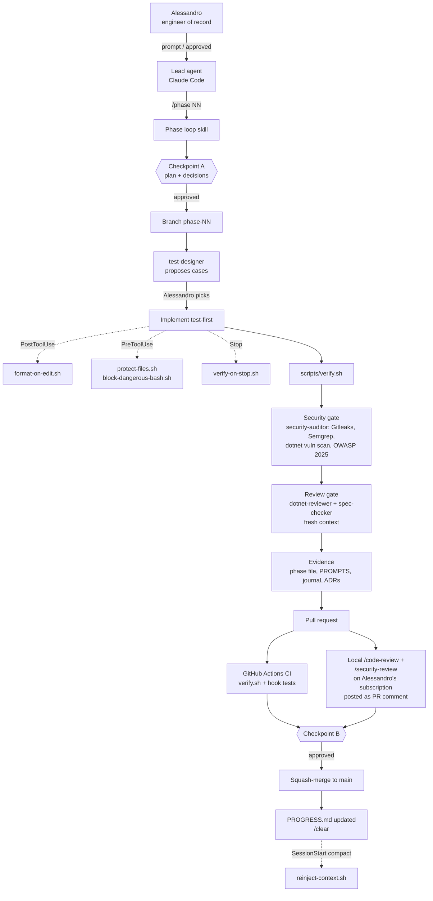

# Orchestration

How the human, the lead agent, skills, subagents, hooks and gates work together. **v1 (Phase 0).** It will be updated as phases run.

## Components and why each was chosen

| Component | Type | Why | Contribution so far |
|---|---|---|---|
| `AGENTS.md` + `CLAUDE.md` | memory | One tool-agnostic source of rules; CLAUDE.md adds only Claude-specific workflow (39 lines) | Phase 0 |
| Nested `CLAUDE.md` (Core, tests, docs) | memory, on demand | Rules load only when that folder is touched | Phase 0 |
| `.claude/rules/*.md` | path-scoped memory | Backend/test/infra rules load only for matching files; security is always loaded | Phase 0 |
| `dotnet-reviewer` (opus) | subagent | Fresh-context review; the author never grades its own work | Not yet invoked |
| `spec-checker` (sonnet) | subagent | Requirement traceability with file/test evidence | Not yet invoked |
| `security-auditor` (opus) | subagent | One place that runs and triages every scanner | Not yet invoked |
| `test-designer` (sonnet) | subagent | Separates test design (human picks) from implementation | Not yet invoked |
| `parallel-implementer` (opus, worktree) | subagent | Isolated parallel phases (4 ∥ 6) | Not yet invoked |
| `/phase`, `/verify-all`, `/progress`, `/adr`, `/retro` | skills (manual only) | Repeatable workflows that load only when typed | Phase 0 |
| `affordability-rules` | skill (auto, path-scoped) | Loads the formulas only when Core or unit tests are touched | Phase 0 |
| 5 hooks | enforcement | Things that must always happen don't rely on the model remembering | Proven by script tests (see phase 0 file) |
| Permissions (allow/deny) | enforcement | Second layer behind the hooks | Phase 0 |
| Gitleaks pre-commit (`.githooks/`) | enforcement | Secrets never reach a commit | Phase 0 |
| CI (`ci.yml`) | enforcement | Independent `verify.sh` + hook tests on every PR | Phase 0 |
| Local `/code-review` + `/security-review` | review | AI review on Alessandro's subscription, no API key or secret in CI; summary posted to the PR | Phase 0 onward |

## What was not installed, and why

| Tool | Reason |
|---|---|
| Microsoft Learn MCP | Alessandro's choice. WebFetch on learn.microsoft.com covers it; fewer MCP tools means a leaner context. |
| NuGet MCP | `dotnet list package --vulnerable --include-transitive` and `dotnet package search` cover it. |
| dotnet/skills plugins, OWASP skill | Not present. The reviewer and auditor carry their own checklists; this avoids third-party skill supply-chain risk. |
| GitHub MCP, Context7 | `gh` CLI and WebFetch are enough. |

## Guardrails

- Hooks: secrets, migrations and `.git` protected; destructive Bash blocked; Stop hook runs the fast verify, with a `stop_hook_active` loop guard.
- CI: least-privilege `permissions:`, actions pinned by commit SHA, no secrets at all. The AI review GitHub workflows were removed (decision 2026-11-14): reviews run locally on the subscription.
- Permissions (D10/D11): narrow auto-approve list; `ask` for harness files, `gh pr merge` and `gh pr comment`; deny for package/tool installs and destructive git.
- Human checkpoints A and B on every phase.

## Parallel runs

- **Phase 4 ∥ Phase 6 (2026-11-15).** Each ran in its own git worktree with its own `parallel-implementer`. The file sets were checked first: Phase 4 avoided `Program.cs` (P4-D1) so they shared no source file; shared docs (`PROGRESS.md`, `PROMPTS.md`, this file, the design journal) were edited only on `main` after each merge. Phase 4 merged first (#7); Phase 6 was rebased with no conflicts, its gates re-run, then merged (#8).
- **What it cost.** Two usage-limit stops and one implementer turn limit had to be resumed by hand; the rebase changed every cited commit hash; the lead agent's context carried both phases at once.
- **Decision after it (Alessandro, P06-12):** phases run one at a time from now on.
